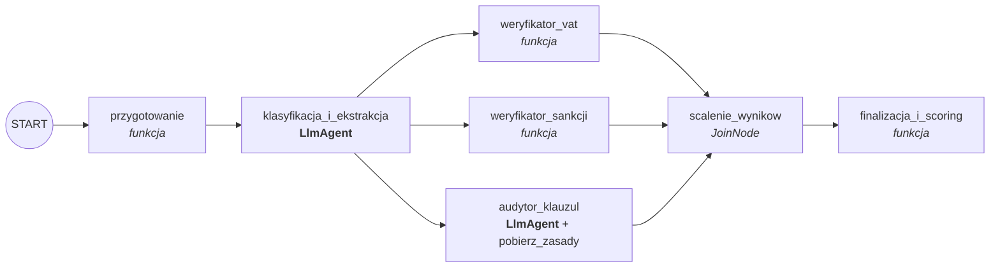
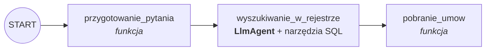
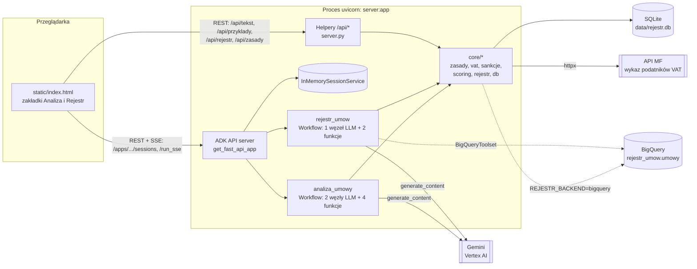
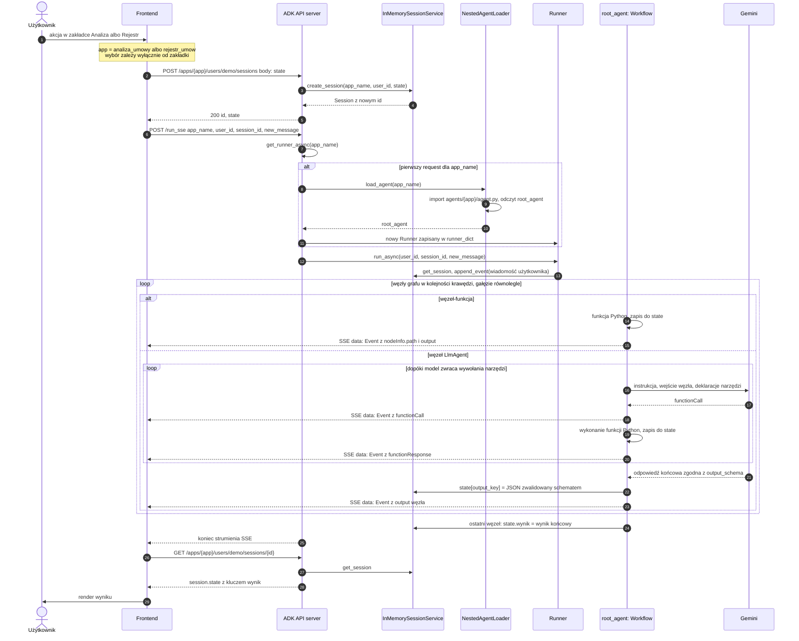
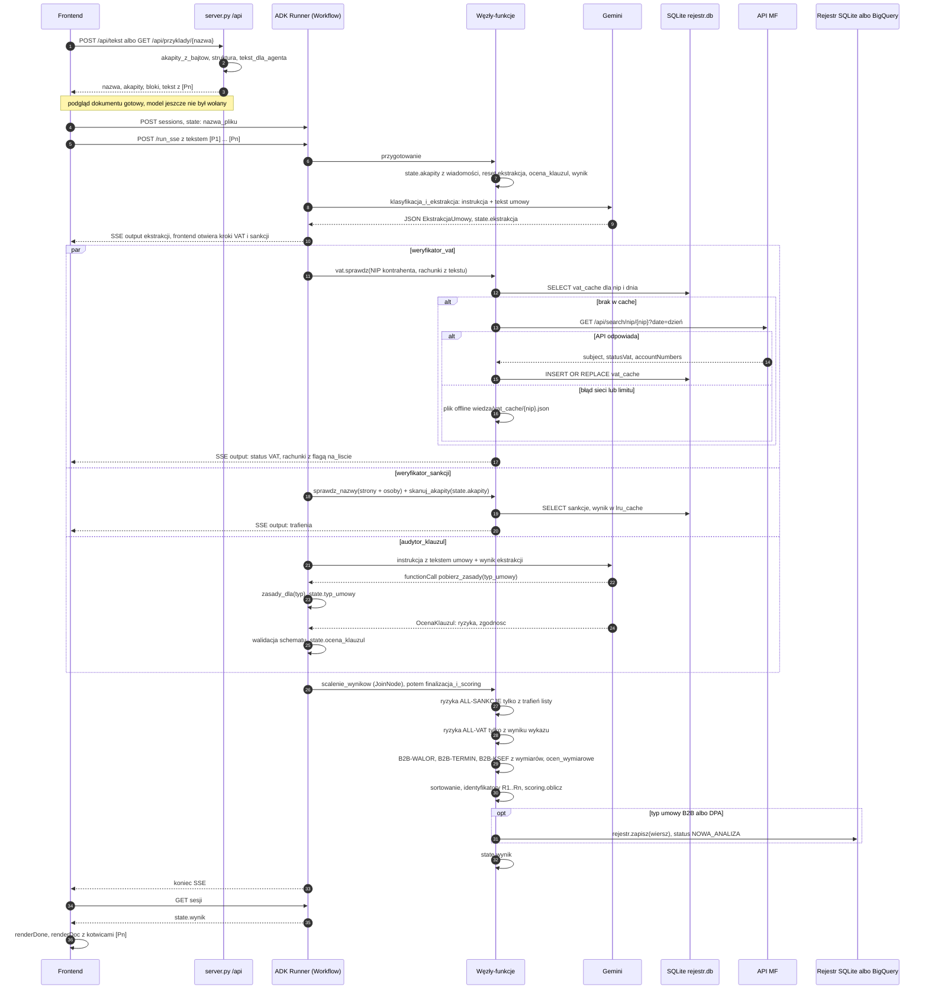
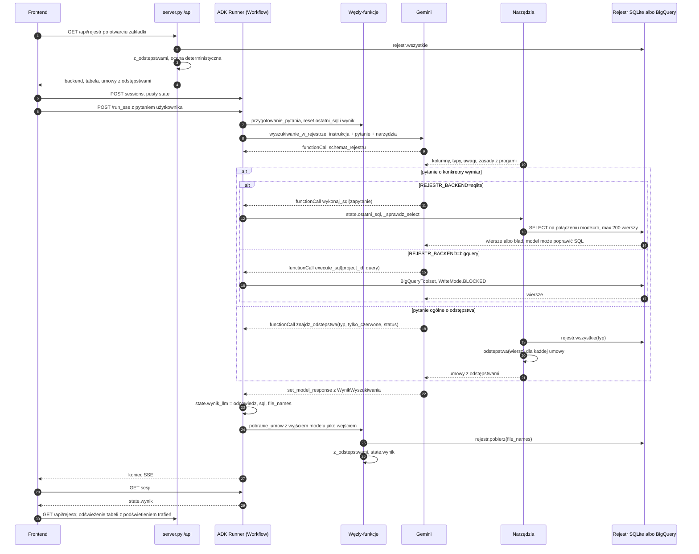

# Komunikacja frontend ↔ agenci ADK

Dokument opisuje, co dzieje się pod spodem od kliknięcia w przeglądarce do wyświetlenia wyniku: jak wybierany jest agent, jak zapytanie trafia do modelu Gemini, jak wywoływane są narzędzia i skąd frontend bierze wynik. Stan opisu odpowiada kodowi z 2026-11-17 (Google ADK 2.14.0, agenty jako grafy `Workflow`).

## 1. Przegląd

Aplikacja to jeden proces FastAPI ([server.py](../server.py)), w którym działają:

- **serwer API Google ADK** (`get_fast_api_app`), który wystawia dwa agenty z katalogu [agents/](../agents/) pod standardowymi endpointami ADK (`/apps/.../sessions`, `/run_sse`, `/list-apps`, Dev UI pod `/dev-ui/`);
- **endpointy pomocnicze `/api/*`**, które nigdy nie wołają modelu: ekstrakcja tekstu z pliku, przykładowe umowy, tabela rejestru, lista zasad;
- **frontend** [static/index.html](../static/index.html) serwowany pod `/` (trasa `/` z ADK, która przekierowuje do Dev UI, jest usuwana w [server.py:36](../server.py#L36)).

| Agent (`app_name`) | Scenariusz | Zakładka UI | Narzędzia modelu | Klucz wyniku w stanie |
| --- | --- | --- | --- | --- |
| `analiza_umowy` | analiza jednej umowy: ryzyka, biała lista VAT, sankcje, score, zapis do rejestru | „Analiza” | `pobierz_zasady` (VAT i sankcje sprawdzają węzły deterministyczne) | `wynik` |
| `rejestr_umow` | pytania w języku naturalnym o odstępstwa w rejestrze umów | „Rejestr” | `schemat_rejestru`, `znajdz_odstepstwa`, `wykonaj_sql` albo BigQuery `execute_sql`/`get_table_info` | `wynik` |

### 1.1. Agenty jako grafy `Workflow`

Oba `root_agent` to grafy `google.adk.workflow.Workflow` (w ADK 2.14 `SequentialAgent` i `ParallelAgent` są oznaczone jako przestarzałe na rzecz `Workflow`). Węzeł grafu to `LlmAgent` (wywołanie Gemini) albo funkcja Python (węzeł deterministyczny, bez modelu). Nie ma agenta-routera ani `transfer_to_agent`. ADK Dev UI (`/dev-ui/`) rysuje oba grafy, a podgląd zdarzeń pokazuje wyjście każdego węzła.

`analiza_umowy` ([agents/analiza_umowy/agent.py:529](../agents/analiza_umowy/agent.py#L529)):



| Węzeł | Rodzaj | Wejście | Wyjście |
| --- | --- | --- | --- |
| `przygotowanie` | funkcja | wiadomość użytkownika `[P1] ... [Pn]` | tekst umowy; `state.akapity`, reset kluczy poprzedniego przebiegu |
| `klasyfikacja_i_ekstrakcja` | `LlmAgent`, `output_schema=EkstrakcjaUmowy` | tekst umowy | `state.ekstrakcja`: typ, strony z NIP, osoby, płatność, kluczowe zapisy, wymiary |
| `weryfikator_vat` | funkcja | `state.ekstrakcja`, `state.akapity` | wynik `vat.sprawdz` dla NIP kontrahenta i wszystkich rachunków z tekstu |
| `weryfikator_sankcji` | funkcja | `state.ekstrakcja`, `state.akapity` | trafienia `sprawdz_nazwy` (strony i osoby) + `skanuj_akapity` |
| `audytor_klauzul` | `LlmAgent` z `pobierz_zasady`, `output_schema=OcenaKlauzul` | wynik ekstrakcji + tekst umowy w instrukcji | `state.ocena_klauzul`: ryzyka i zgodne zasady |
| `scalenie_wynikow` | `JoinNode` | wyjścia trzech gałęzi | słownik `{nazwa węzła: wyjście}` |
| `finalizacja_i_scoring` | funkcja | wyjście `scalenie_wynikow`, `state.ekstrakcja` | `state.wynik`, zapis do rejestru |

Trzy węzły po ekstrakcji działają równolegle. Węzły VAT i sankcji kończą się w ułamku sekundy, więc czas gałęzi wyznacza audytor.

`rejestr_umow` ([agents/rejestr_umow/agent.py:158](../agents/rejestr_umow/agent.py#L158)):



## 2. Komponenty



| Moduł | Rola w komunikacji |
| --- | --- |
| [core/config.py](../core/config.py) | ładuje `.env`, model, backend rejestru, timeout i retry wywołań Gemini |
| [core/tekst.py](../core/tekst.py) | DOCX/TXT → akapity → tekst `[P1] ...` dla agenta i z powrotem |
| [core/struktura.py](../core/struktura.py) | bloki podglądu dokumentu (numer akapitu `p` = `[Pn]` agenta) |
| [core/zasady.py](../core/zasady.py) | baza zasad Grupy Pelion i deterministyczna ocena wierszy rejestru |
| [core/vat.py](../core/vat.py) | klient białej listy VAT z cache SQLite i plikiem offline |
| [core/sankcje.py](../core/sankcje.py) | dopasowanie nazw i tekstu umowy do listy sankcyjnej MSWiA |
| [core/scoring.py](../core/scoring.py) | deterministyczny score 0–100 |
| [core/rejestr.py](../core/rejestr.py) | jeden interfejs rejestru: SQLite albo BigQuery |
| [core/db.py](../core/db.py), [core/bq.py](../core/bq.py) | schemat, seed, zapis wiersza (SQLite `INSERT OR REPLACE`, BigQuery `MERGE`) |

## 3. Wybór agenta i droga zapytania

### 3.1. Kto wybiera agenta

Agenta wybiera **frontend, na sztywno, według zakładki**. Model nie bierze udziału w wyborze:

- zakładka „Analiza”, przycisk analizy → `runAgent("analiza_umowy", ...)` ([static/index.html:948](../static/index.html#L948));
- zakładka „Rejestr”, pytanie lub chip → `runAgent("rejestr_umow", ...)` ([static/index.html:1054](../static/index.html#L1054)).

`app_name` to nazwa katalogu w [agents/](../agents/). ADK (z `web=True` jest to `NestedAgentLoader`) przy pierwszym żądaniu dla danego `app_name` importuje moduł `agents/<app_name>/agent.py` i bierze z niego obiekt `root_agent` (loader przyjmuje `BaseAgent` albo węzeł `BaseNode`, czyli także `Workflow`). Następnie:

1. agent trafia do cache loadera (`_agent_cache`);
2. ADK owija go w `App` i tworzy `Runner`, zapisywany w `runner_dict[app_name]` (`get_runner_async` w `google/adk/cli/api_server.py`);
3. kolejne żądania z tym samym `app_name` używają gotowego `Runner`.

Konsekwencja: kod na poziomie modułu agenta (np. `_narzedzia()` i `SQL_HINT` w [agents/rejestr_umow/agent.py:79-136](../agents/rejestr_umow/agent.py#L79-L136)) wykonuje się raz na proces. Zmiana `REJESTR_BACKEND` wymaga restartu serwera.

Listę dostępnych agentów zwraca `GET /list-apps` (z niej korzysta Dev UI pod `/dev-ui/`, gdzie agenta wybiera się z listy rozwijanej).

### 3.2. Sekwencja wspólna dla obu agentów

Funkcja `runAgent` ([static/index.html:576-603](../static/index.html#L576-L603)) realizuje zawsze te same trzy kroki: utworzenie sesji, uruchomienie agenta ze strumieniem SSE, odczyt stanu sesji.



Zasady, które wynikają z tej sekwencji:

- **Każde kliknięcie tworzy nową sesję.** Agenty nie mają pamięci rozmowy między kolejnymi pytaniami. `user_id` jest stały (`"demo"`, [static/index.html:542](../static/index.html#L542)).
- **Sesje są w pamięci procesu.** `use_local_storage=False` w [server.py:36](../server.py#L36) powoduje użycie `InMemorySessionService`. Restart serwera usuwa wszystkie sesje.
- **SSE służy tylko do pokazywania postępu.** Frontend wyświetla z niego kroki (funkcja `steps` w [static/index.html:636](../static/index.html#L636)): `functionCall` → nowa pozycja, `functionResponse` → wynik kroku, a zdarzenie z `output` węzła deterministycznego (`NODE_RESULT`, [static/index.html:622](../static/index.html#L622)) → wynik kroku VAT albo sankcji. Wynik końcowy pochodzi z `GET` sesji, bo powstaje w ostatnim węźle grafu, a nie w odpowiedzi modelu.
- **`streaming: false`** oznacza `StreamingMode.NONE`: transport to nadal SSE, ale każde zdarzenie jest kompletną odpowiedzią modelu albo narzędzia, bez fragmentów tokenów.

### 3.3. Co dokładnie dostaje model

Węzeł `LlmAgent` w grafie działa w trybie `single_turn`: model **widzi tylko wejście węzła** (wyjście poprzedniego węzła, wstawione jako wiadomość użytkownika) i własne wywołania narzędzi, a nie całą historię sesji. Przy każdym wywołaniu Gemini ADK składa żądanie z:

1. **instrukcji systemowej** – pole `instruction` węzła ([agents/analiza_umowy/agent.py:178](../agents/analiza_umowy/agent.py#L178), [agents/analiza_umowy/agent.py:273-290](../agents/analiza_umowy/agent.py#L273-L290), [agents/rejestr_umow/agent.py:143](../agents/rejestr_umow/agent.py#L143)) plus dopiski ADK;
2. **wejścia węzła** – dla `klasyfikacja_i_ekstrakcja` tekst umowy z węzła `przygotowanie`, dla `audytor_klauzul` wynik ekstrakcji (JSON), dla `wyszukiwanie_w_rejestrze` pytanie użytkownika – oraz dotychczasowych par `functionCall`/`functionResponse` tego węzła;
3. **deklaracji narzędzi** – generowanych z sygnatur i docstringów funkcji Python. Parametr `tool_context: ToolContext` jest ukryty przed modelem i wstrzykiwany przez ADK;
4. **konfiguracji generowania** z `config.model_config()` ([core/config.py:39](../core/config.py#L39)): `temperature=0.2`, timeout 90 s na wywołanie, do 3 prób z backoffem 1–8 s dla HTTP 408/429/500/502/503/504.

Audytor potrzebuje dosłownego tekstu umowy do cytatów, a jego wejściem jest tylko wynik ekstrakcji. Dlatego jego instrukcja jest funkcją (`_instrukcja_audytora`), która dokleja tekst `[P1] ... [Pn]` ze `state.akapity`. Poza tym stan sesji (np. `nazwa_pliku`) **nie trafia do promptu**: instrukcje nie zawierają placeholderów `{klucz}`, a stan czytają narzędzia i węzły-funkcje.

**Wynik strukturalny.** `klasyfikacja_i_ekstrakcja` ma tylko `output_schema`, więc Gemini zwraca JSON natywnie (`response_schema`). `audytor_klauzul` i `wyszukiwanie_w_rejestrze` mają jednocześnie `tools` i `output_schema`. Gdy model nie obsługuje natywnie obu naraz, ADK dokłada narzędzie `set_model_response` z schematem Pydantic (`google/adk/flows/llm_flows/prompt/_schema.py`). Model oddaje wtedy wynik końcowy jako wywołanie tego narzędzia, ADK waliduje JSON schematem i zapisuje go w `state[output_key]`. Frontend pomija `set_model_response` na liście kroków.

**Kolejność kroków.** W `analiza_umowy` kolejność wyznacza graf: ekstrakcja, potem równolegle VAT, sankcje i audyt, na końcu scoring. Model decyduje tylko o narzędziach wewnątrz swojego węzła. Frontend obsługuje równoległe `functionCall` zbiorem `pending` i dopiero po komplecie odpowiedzi pokazuje krok „Gemini porównuje zapisy...”.

## 4. Protokół HTTP

### 4.1. Endpointy

| Metoda i ścieżka | Właściciel | Model? | Opis |
| --- | --- | --- | --- |
| `GET /` | [server.py:72](../server.py#L72) | nie | frontend |
| `GET /api/przyklady` | [server.py:77](../server.py#L77) | nie | lista przykładowych umów z `wiedza/` |
| `GET /api/przyklady/{nazwa}` | [server.py:82](../server.py#L82) | nie | akapity, bloki podglądu i tekst `[Pn]` przykładu |
| `POST /api/tekst` | [server.py:90](../server.py#L90) | nie | to samo dla wgranego pliku (multipart `plik`, TXT/MD/DOCX, max 15 MB) |
| `GET /api/rejestr` | [server.py:110](../server.py#L110) | nie | cały rejestr z odstępstwami wyliczonymi deterministycznie |
| `GET /api/zasady` | [server.py:122](../server.py#L122) | nie | lista zasad `ZASADY` |
| `GET /list-apps` | ADK | nie | nazwy agentów z `agents/` |
| `POST /apps/{app}/users/{user}/sessions` | ADK | nie | nowa sesja ze stanem początkowym |
| `GET /apps/{app}/users/{user}/sessions/{id}` | ADK | nie | sesja ze stanem i zdarzeniami |
| `POST /run_sse` | ADK | **tak** | uruchomienie agenta, odpowiedź `text/event-stream` |
| `GET /dev-ui/` | ADK | – | ADK Dev UI dla tych samych agentów |
| `GET /dev/apps/{app}/graph` | ADK | nie | graf agenta w formacie DOT (z niego Dev UI rysuje workflow) |

### 4.2. Format żądań

Utworzenie sesji (analiza umowy przekazuje nazwę pliku, rejestr pusty stan):

```http
POST /apps/analiza_umowy/users/demo/sessions
Content-Type: application/json

{"state": {"nazwa_pliku": "umowa_demo_b2b.txt"}}
```

Uruchomienie agenta:

```http
POST /run_sse
Content-Type: application/json
Accept: text/event-stream

{
  "app_name": "analiza_umowy",
  "user_id": "demo",
  "session_id": "<id z poprzedniego kroku>",
  "streaming": false,
  "new_message": {"role": "user", "parts": [{"text": "[P1] UMOWA O ŚWIADCZENIE USŁUG\n[P2] ..."}]}
}
```

### 4.3. Format strumienia SSE

Pełne, rzeczywiste przykłady żądań i odpowiedzi (sesja, wszystkie zdarzenia SSE analizy, stan z wynikiem, rejestr) są w [przyklady-komunikacji-adk.md](przyklady-komunikacji-adk.md).

Każde zdarzenie ADK to jedna linia `data: <JSON>` zakończona pustą linią. Pola są w camelCase (`functionCall`, `functionResponse`, `nodeInfo`). Każde zdarzenie ma `nodeInfo.path` z węzłem, który je wysłał (`<workflow>@<przebieg>/<węzeł>@<przebieg>`). Zdarzenie kończące węzeł ma pole `output`. Przykład skrócony dla `analiza_umowy`:

```text
data: {"author":"klasyfikacja_i_ekstrakcja","nodeInfo":{"path":"analiza_umowy@1/klasyfikacja_i_ekstrakcja@1"},"content":{"parts":[{"text":"{...}"}]},"output":{"typ_umowy":"B2B","strony":[...],...}, ...}

data: {"author":"analiza_umowy","nodeInfo":{"path":"analiza_umowy@1/weryfikator_vat@1"},"output":{"nip":"5260250274","status_vat":"Czynny","rachunki":[...]}, ...}

data: {"author":"audytor_klauzul","nodeInfo":{"path":"analiza_umowy@1/audytor_klauzul@1"},"content":{"role":"model","parts":[{"functionCall":{"id":"adk-…","name":"pobierz_zasady","args":{"typ_umowy":"B2B"}}}]}, ...}
```

Węzły-funkcje nie mają `content`, więc nie wysyłają `functionCall`. Frontend rozpoznaje je po `nodeInfo.path` i `output`: wynik ekstrakcji otwiera kroki „Wykaz podatników VAT MF” i „Lista sankcyjna MSWiA”, a wyjścia `weryfikator_vat` i `weryfikator_sankcji` je zamykają.

Błąd w trakcie działania agenta nie zmienia kodu HTTP (nagłówki 200 zostały już wysłane). ADK wysyła wtedy zdarzenie `data: {"error": "<Typ>: <komunikat>", "error_details": {...}}`, a frontend zamienia je na wyjątek ([static/index.html:597](../static/index.html#L597)).

## 5. Scenariusz 1: `analiza_umowy`



### 5.1. Podział odpowiedzialności model ↔ kod

| Element wyniku | Źródło | Gdzie |
| --- | --- | --- |
| typ umowy, strony, osoby, podsumowanie, kluczowe zapisy, cytaty, wymiary | model, węzeł `klasyfikacja_i_ekstrakcja` | schemat `EkstrakcjaUmowy`, [agent.py:123](../agents/analiza_umowy/agent.py#L123) |
| ryzyka i zgodność z zasad B2B/DPA/NDA i `ALL-*` (poza sankcjami, VAT i trzema wymiarowymi) | model, węzeł `audytor_klauzul` | schemat `OcenaKlauzul`, [agent.py:140](../agents/analiza_umowy/agent.py#L140) |
| wybór NIP kontrahenta i rachunków do sprawdzenia | kod, z wyniku ekstrakcji i tekstu umowy | `weryfikator_vat`, [agent.py:198-232](../agents/analiza_umowy/agent.py#L198-L232) |
| ryzyka `ALL-SANKCJE` | kod, lista MSWiA | `weryfikator_sankcji` i `_ryzyko_sankcyjne`, [agent.py:235](../agents/analiza_umowy/agent.py#L235), [agent.py:315](../agents/analiza_umowy/agent.py#L315) |
| ryzyka `ALL-VAT` | kod, wykaz MF | `_ryzyko_vat`, [agent.py:335](../agents/analiza_umowy/agent.py#L335) |
| poziom `B2B-WALOR`, `B2B-TERMIN`, `B2B-KSEF` | kod, z wymiarów wyekstrahowanych przez model | `_wymus_zasady_wymiarowe`, [agent.py:376](../agents/analiza_umowy/agent.py#L376) |
| score 0–100 i poziom | kod | [core/scoring.py:32](../core/scoring.py#L32) |
| zapis do rejestru | kod | `_zapisz_w_rejestrze`, [agent.py:428](../agents/analiza_umowy/agent.py#L428) |

Sprawdzenia VAT i sankcji wykonują węzły deterministyczne, zawsze, bez udziału modelu: audytor ma w instrukcji polecenie pominięcia `ALL-SANKCJE` i `ALL-VAT`, a `finalizacja_i_scoring` i tak usuwa takie ryzyka od modelu i odtwarza je wyłącznie z wyników weryfikatorów. Gdy w umowie nie ma 10-cyfrowego NIP-u kontrahenta, `weryfikator_vat` zwraca `{"blad": "brak NIP kontrahenta w umowie"}`, a UI pokazuje „nie sprawdzono”. Cytat ryzyka sankcyjnego to sama nazwa z ekstrakcji, gdy występuje dosłownie w akapicie, w przeciwnym razie cały akapit.

Cytaty wskazują numer akapitu `[Pn]`. Ten sam numer ma pole `p` bloków z [core/struktura.py](../core/struktura.py), więc frontend nanosi ryzyka bezpośrednio na podgląd dokumentu.

## 6. Scenariusz 2: `rejestr_umow`



Model zwraca **tylko nazwy plików** (`file_names`). Pełne wiersze i ich odstępstwa ładuje węzeł `pobranie_umow` z rejestru ([agents/rejestr_umow/agent.py:110-129](../agents/rejestr_umow/agent.py#L110-L129)), więc tabela w UI zawsze pokazuje dane z bazy, a nie tekst wygenerowany przez model.

Zestaw narzędzi zależy od backendu ([agents/rejestr_umow/agent.py:79-99](../agents/rejestr_umow/agent.py#L79-L99)):

| `REJESTR_BACKEND` | Narzędzie SQL | Zabezpieczenie zapisu | Źródło pola `sql` w wyniku |
| --- | --- | --- | --- |
| `sqlite` (domyślnie bez `BQ_PROJECT`) | `wykonaj_sql` | regex `SELECT`/`WITH`, brak `;`, połączenie `mode=ro`, limit 200 wierszy | pole `sql` od modelu, w razie braku `state.ostatni_sql` |
| `bigquery` (domyślnie, gdy jest `BQ_PROJECT`) | `execute_sql`, `get_table_info` z `BigQueryToolset` | `WriteMode.BLOCKED` | wyłącznie pole `sql` od modelu (toolset nie zapisuje `ostatni_sql`) |

## 7. Stan sesji jako kontrakt

Stan sesji ADK łączy węzły grafu, narzędzia i frontend. Frontend czyta tylko klucz `wynik`. Wyniki weryfikatorów VAT i sankcji nie trafiają do stanu: płyną krawędziami grafu przez `scalenie_wynikow` do `finalizacja_i_scoring` (widać je w Dev UI jako wyjścia węzłów).

**`analiza_umowy`**

| Klucz | Zapisuje | Czyta |
| --- | --- | --- |
| `nazwa_pliku` | frontend przy tworzeniu sesji | `finalizacja_i_scoring` (`file_name` w rejestrze) |
| `akapity` | `przygotowanie` | `weryfikator_vat`, `weryfikator_sankcji`, instrukcja audytora, `finalizacja_i_scoring` (cytaty, numery akapitów) |
| `ekstrakcja` | ADK (`output_key` węzła `klasyfikacja_i_ekstrakcja`) | `weryfikator_vat`, `weryfikator_sankcji`, `finalizacja_i_scoring` |
| `typ_umowy` | `pobierz_zasady` | nie jest dalej odczytywany (widoczny w Dev UI) |
| `ocena_klauzul` | ADK (`output_key` węzła `audytor_klauzul`) | `finalizacja_i_scoring` (gdy brak go w wejściu z `scalenie_wynikow`) |
| `wynik` | `finalizacja_i_scoring` | frontend |

**`rejestr_umow`**

| Klucz | Zapisuje | Czyta |
| --- | --- | --- |
| `ostatni_sql` | `wykonaj_sql`, reset w `przygotowanie_pytania` | `pobranie_umow` |
| `wynik_llm` | ADK (`output_key`) | widoczny w Dev UI; `pobranie_umow` dostaje ten sam wynik jako wejście węzła |
| `wynik` | `pobranie_umow` | frontend |

## 8. Konfiguracja

Zmienne środowiskowe z `.env` w katalogu głównym (ładowane w [core/config.py](../core/config.py)):

| Zmienna | Domyślnie | Znaczenie |
| --- | --- | --- |
| `GEMINI_MODEL` | `gemini-4-argon` | model wszystkich węzłów LLM |
| `GOOGLE_GENAI_USE_VERTEXAI` | – | `TRUE` kieruje wywołania do Vertex AI (ustawione w `.env`) |
| `GOOGLE_CLOUD_PROJECT`, `GOOGLE_CLOUD_LOCATION` | – | projekt i region Vertex AI; `GOOGLE_CLOUD_PROJECT` jest też domyślnym `BQ_PROJECT` |
| `GOOGLE_APPLICATION_CREDENTIALS` | – | plik konta serwisowego dla Vertex AI i BigQuery |
| `GEMINI_API_KEY` | – | klucz Gemini API, używany gdy Vertex AI jest wyłączony |
| `GEMINI_TIMEOUT_MS` | `90000` | limit czasu jednego wywołania modelu |
| `REJESTR_BACKEND` | `bigquery`, gdy jest `BQ_PROJECT`, inaczej `sqlite` | `sqlite` albo `bigquery`; wymaga restartu serwera |
| `REJESTR_DB` | `data/rejestr.db` | ścieżka bazy SQLite (rejestr, zasady, sankcje, cache VAT) |
| `BQ_PROJECT`, `BQ_DATASET`, `BQ_LOCATION` | `GOOGLE_CLOUD_PROJECT`, `rejestr_umow`, `EU` | lokalizacja tabeli BigQuery |

Baza SQLite tworzy się sama przy starcie serwera (`db.upewnij_sie()` w [server.py:33](../server.py#L33)). Tabela BigQuery wymaga jednorazowego `uv run python -m core.bq --seed`.

## 9. Obsługa błędów

| Sytuacja | Zachowanie | Widoczne w UI |
| --- | --- | --- |
| nieobsługiwany format pliku | `415` z `/api/tekst` | alert z komunikatem |
| uszkodzony DOCX, pusty plik | `400` | alert |
| plik powyżej 15 MB | `413` | alert |
| chwilowy błąd Gemini (408/429/5xx) | do 3 prób w `google-genai`, potem wyjątek | zdarzenie `error` w SSE → krok „Błąd” i przycisk ponowienia |
| model nie zwrócił wyniku zgodnego ze schematem | brak `state.ekstrakcja`/`wynik_llm`, ostatni węzeł kończy bez wyniku | „Agent nie zwrócił wyniku.” |
| API MF niedostępne | plik `wiedza/vat_cache/<nip>.json`, gdy brak → `{"blad": ...}` | krok VAT na czerwono, brak ryzyk `ALL-VAT` z wykazu |
| brak NIP kontrahenta w umowie | `weryfikator_vat` zwraca `{"blad": "brak NIP kontrahenta w umowie"}` bez zapytania do MF | krok VAT na czerwono, w werdykcie „nie sprawdzono” |
| błędny SQL modelu (SQLite) | `{"blad": ...}` wraca do modelu, który może poprawić zapytanie | krok „błąd SQL” |
| błąd zapisu do rejestru | analiza zwracana normalnie, `zapis_rejestru.ok = false` | wynik analizy bez zapisu |
| rejestr niedostępny w `/api/rejestr` | `502` z nazwą backendu | komunikat zamiast tabeli |
| restart serwera w trakcie | sesje w pamięci znikają | ponowne uruchomienie analizy |

## 10. Bezpieczeństwo i ograniczenia

- `get_fast_api_app(web=True)` uruchamia serwer deweloperski ADK **bez uwierzytelniania**. Serwer należy wiązać do `127.0.0.1`. [server.py](../server.py) nie przekazuje `bind_host`, więc ADK traktuje serwer jako wystawiony na zewnątrz i wyłącza wbudowane agenty specjalne (`__*`); endpointy obu agentów pozostają dostępne dla każdego, kto dotrze do portu.
- Wszystkie żądania idą jako ten sam użytkownik `demo`; brak izolacji między użytkownikami.
- SQL generowany przez model jest ograniczony do odczytu na dwóch poziomach: walidacja tekstu zapytania i połączenie tylko do odczytu (SQLite) albo `WriteMode.BLOCKED` (BigQuery).
- Treść umowy trafia w całości do Gemini (Vertex AI). NIP kontrahenta trafia do publicznego API MF.

## 11. Uruchomienie i diagnostyka

```bash
uv run uvicorn server:app --port 8001
# frontend:      http://127.0.0.1:8001
# ADK Dev UI:    http://127.0.0.1:8001/dev-ui/   (te same agenty, graf workflow, podgląd zdarzeń i stanu)
```

Wywołanie agenta z terminala przez HTTP (ta sama ścieżka co frontend):

```bash
SID=$(curl -s -X POST http://127.0.0.1:8001/apps/rejestr_umow/users/demo/sessions \
  -H 'Content-Type: application/json' -d '{"state": {}}' | python3 -c 'import json,sys; print(json.load(sys.stdin)["id"])')

curl -sN -X POST http://127.0.0.1:8001/run_sse -H 'Content-Type: application/json' -d '{
  "app_name": "rejestr_umow", "user_id": "demo", "session_id": "'"$SID"'", "streaming": false,
  "new_message": {"role": "user", "parts": [{"text": "Umowy B2B z limitem kar powyżej 10%"}]}}'

curl -s http://127.0.0.1:8001/apps/rejestr_umow/users/demo/sessions/$SID \
  | python3 -c 'import json,sys; print(json.dumps(json.load(sys.stdin)["state"]["wynik"], ensure_ascii=False, indent=2))'
```

Wywołanie bez HTTP: skrypty w [scripts/](../scripts/) używają `InMemoryRunner(node=root_agent)` (workflow przekazuje się jako `node`, nie `agent`), z pominięciem serwera, `AgentLoader` i SSE. Sekwencja węzłów, narzędzia i stan są takie same.

```bash
uv run python scripts/uruchom_analize.py wiedza/demo/umowa_demo_b2b.txt
uv run python scripts/zapytaj_rejestr.py "Znajdź umowy powierzenia bez zapisu o termination_data_policy"
```
