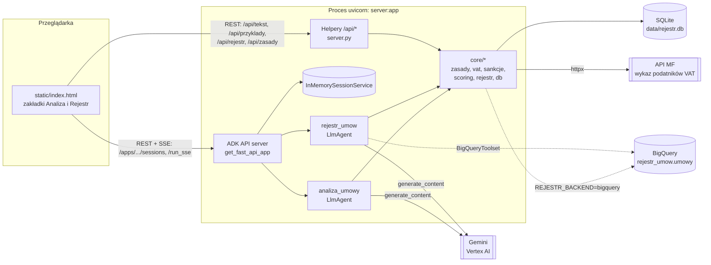
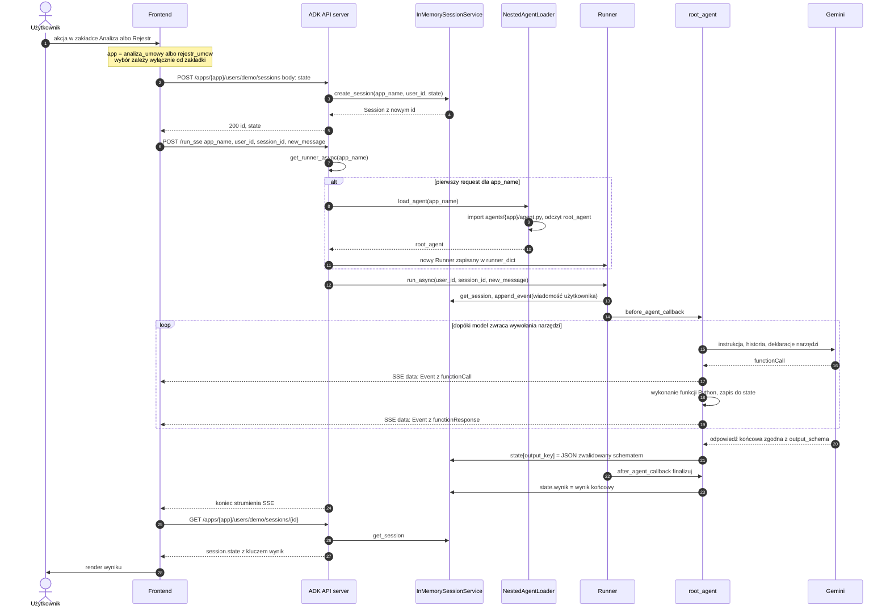
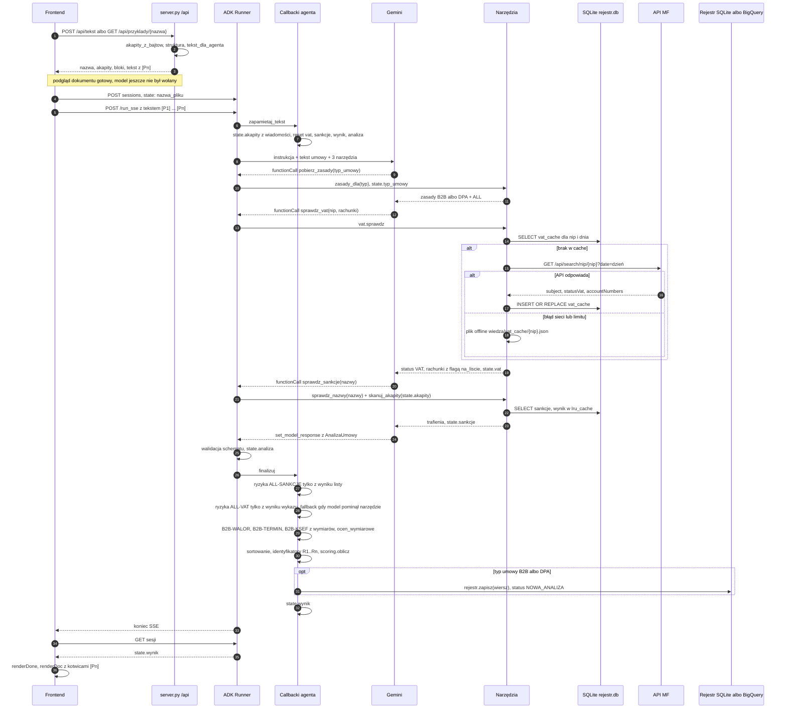
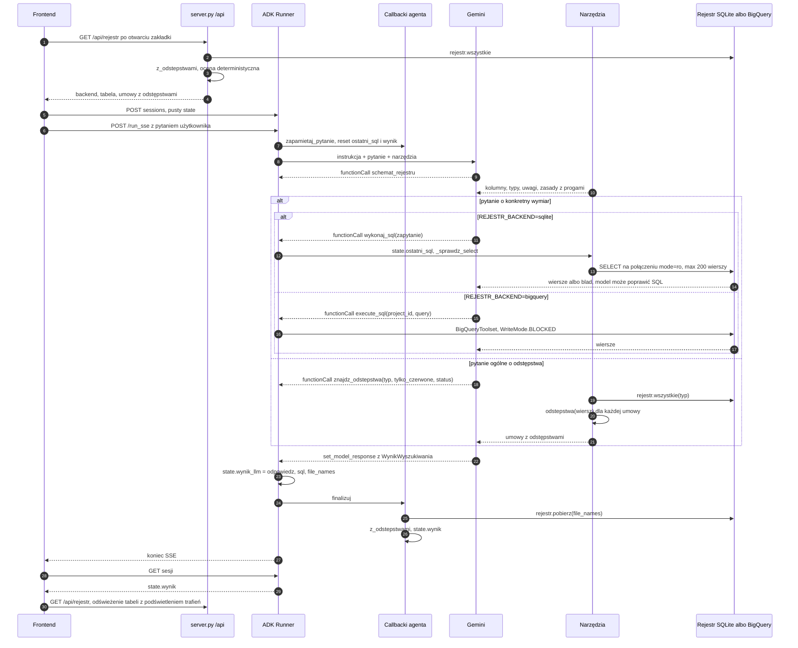

# Komunikacja frontend ↔ agenci ADK

Dokument opisuje, co dzieje się pod spodem od kliknięcia w przeglądarce do wyświetlenia wyniku: jak wybierany jest agent, jak zapytanie trafia do modelu Gemini, jak wywoływane są narzędzia i skąd frontend bierze wynik. Stan opisu odpowiada kodowi z 2026-11-16 (Google ADK 2.14.0).

## 1. Przegląd

Aplikacja to jeden proces FastAPI ([server.py](../server.py)), w którym działają:

- **serwer API Google ADK** (`get_fast_api_app`), który wystawia dwa agenty z katalogu [agents/](../agents/) pod standardowymi endpointami ADK (`/apps/.../sessions`, `/run_sse`, `/list-apps`, Dev UI pod `/dev-ui/`);
- **endpointy pomocnicze `/api/*`**, które nigdy nie wołają modelu: ekstrakcja tekstu z pliku, przykładowe umowy, tabela rejestru, lista zasad;
- **frontend** [static/index.html](../static/index.html) serwowany pod `/` (trasa `/` z ADK, która przekierowuje do Dev UI, jest usuwana w [server.py:36](../server.py#L36)).

| Agent (`app_name`) | Scenariusz | Zakładka UI | Narzędzia | Klucz wyniku w stanie |
| --- | --- | --- | --- | --- |
| `analiza_umowy` | analiza jednej umowy: ryzyka, biała lista VAT, sankcje, score, zapis do rejestru | „Analiza” | `pobierz_zasady`, `sprawdz_vat`, `sprawdz_sankcje` | `wynik` |
| `rejestr_umow` | pytania w języku naturalnym o odstępstwa w rejestrze umów | „Rejestr” | `schemat_rejestru`, `znajdz_odstepstwa`, `wykonaj_sql` albo BigQuery `execute_sql`/`get_table_info` | `wynik` |

Oba agenty to pojedyncze `LlmAgent` bez sub-agentów. Nie ma agenta-routera ani `transfer_to_agent`.

## 2. Komponenty



| Moduł | Rola w komunikacji |
| --- | --- |
| [core/config.py](../core/config.py) | ładuje `.env`, model, backend rejestru, timeout i retry wywołań Gemini |
| [core/tekst.py](../core/tekst.py) | DOCX/TXT → akapity → tekst `[P1] ...` dla agenta i z powrotem |
| [core/struktura.py](../core/struktura.py) | bloki podglądu dokumentu (numer akapitu `p` = `[Pn]` agenta) |
| [core/zasady.py](../core/zasady.py) | baza zasad Grupy Pelion i deterministyczna ocena wierszy rejestru |
| [core/vat.py](../core/vat.py) | klient białej listy VAT z cache SQLite i plikiem offline |
| [core/sankcje.py](../core/sankcje.py) | dopasowanie nazw i tekstu umowy do listy sankcyjnej MSWiA |
| [core/scoring.py](../core/scoring.py) | deterministyczny score 0–100 |
| [core/rejestr.py](../core/rejestr.py) | jeden interfejs rejestru: SQLite albo BigQuery |
| [core/db.py](../core/db.py), [core/bq.py](../core/bq.py) | schemat, seed, zapis wiersza (SQLite `INSERT OR REPLACE`, BigQuery `MERGE`) |

## 3. Wybór agenta i droga zapytania

### 3.1. Kto wybiera agenta

Agenta wybiera **frontend, na sztywno, według zakładki**. Model nie bierze udziału w wyborze:

- zakładka „Analiza”, przycisk analizy → `runAgent("analiza_umowy", ...)` ([static/index.html:711](../static/index.html#L711));
- zakładka „Rejestr”, pytanie lub chip → `runAgent("rejestr_umow", ...)` ([static/index.html:799](../static/index.html#L799)).

`app_name` to nazwa katalogu w [agents/](../agents/). ADK (z `web=True` jest to `NestedAgentLoader`) przy pierwszym żądaniu dla danego `app_name` importuje moduł `agents/<app_name>/agent.py` i bierze z niego obiekt `root_agent`. Następnie:

1. agent trafia do cache loadera (`_agent_cache`);
2. ADK owija go w `App` i tworzy `Runner`, zapisywany w `runner_dict[app_name]` (`get_runner_async` w `google/adk/cli/api_server.py`);
3. kolejne żądania z tym samym `app_name` używają gotowego `Runner`.

Konsekwencja: kod na poziomie modułu agenta (np. `_narzedzia()` i `SQL_HINT` w [agents/rejestr_umow/agent.py:76-129](../agents/rejestr_umow/agent.py#L76-L129)) wykonuje się raz na proces. Zmiana `REJESTR_BACKEND` wymaga restartu serwera.

Listę dostępnych agentów zwraca `GET /list-apps` (z niej korzysta Dev UI pod `/dev-ui/`, gdzie agenta wybiera się z listy rozwijanej).

### 3.2. Sekwencja wspólna dla obu agentów

Funkcja `runAgent` ([static/index.html:361-388](../static/index.html#L361-L388)) realizuje zawsze te same trzy kroki: utworzenie sesji, uruchomienie agenta ze strumieniem SSE, odczyt stanu sesji.



Zasady, które wynikają z tej sekwencji:

- **Każde kliknięcie tworzy nową sesję.** Agenty nie mają pamięci rozmowy między kolejnymi pytaniami. `user_id` jest stały (`"demo"`, [static/index.html:329](../static/index.html#L329)).
- **Sesje są w pamięci procesu.** `use_local_storage=False` w [server.py:34](../server.py#L34) powoduje użycie `InMemorySessionService`. Restart serwera usuwa wszystkie sesje.
- **SSE służy tylko do pokazywania postępu.** Frontend wyświetla z niego kroki (`functionCall` → nowa pozycja, `functionResponse` → wynik kroku, funkcja `steps` w [static/index.html:413](../static/index.html#L413)). Wynik końcowy pochodzi z `GET` sesji, bo powstaje w `after_agent_callback`, a nie w odpowiedzi modelu.
- **`streaming: false`** oznacza `StreamingMode.NONE`: transport to nadal SSE, ale każde zdarzenie jest kompletną odpowiedzią modelu albo narzędzia, bez fragmentów tokenów.

### 3.3. Co dokładnie dostaje model

Przy każdym wywołaniu Gemini ADK składa żądanie z:

1. **instrukcji systemowej** – pole `instruction` agenta ([agents/analiza_umowy/agent.py:421-437](../agents/analiza_umowy/agent.py#L421-L437), [agents/rejestr_umow/agent.py:136-145](../agents/rejestr_umow/agent.py#L136-L145)) plus dopiski ADK;
2. **historii bieżącego wywołania** – wiadomość użytkownika oraz dotychczasowe pary `functionCall`/`functionResponse`;
3. **deklaracji narzędzi** – generowanych z sygnatur i docstringów funkcji Python. Parametr `tool_context: ToolContext` jest ukryty przed modelem i wstrzykiwany przez ADK;
4. **konfiguracji generowania** z `config.model_config()` ([core/config.py:36-47](../core/config.py#L36-L47)): `temperature=0.2`, timeout 90 s na wywołanie, do 3 prób z backoffem 1–8 s dla HTTP 408/429/500/502/503/504.

Stan sesji (np. `nazwa_pliku`) **nie trafia do promptu**: instrukcje nie zawierają placeholderów `{klucz}`. Stan jest czytany wyłącznie przez narzędzia i callbacki.

**Wynik strukturalny.** Oba agenty mają jednocześnie `tools` i `output_schema`. Gdy model nie obsługuje natywnie obu naraz, ADK dokłada narzędzie `set_model_response` z schematem Pydantic (`google/adk/flows/llm_flows/prompt/_schema.py`). Model oddaje wtedy wynik końcowy jako wywołanie tego narzędzia, ADK waliduje JSON schematem i zapisuje go w `state[output_key]`. Frontend pomija `set_model_response` na liście kroków.

**Kolejność narzędzi** wynika z instrukcji, ale decyduje o niej model. Model może zwrócić kilka `functionCall` w jednej odpowiedzi (wywołania równoległe). Frontend obsługuje to zbiorem `pending` i dopiero po komplecie odpowiedzi pokazuje krok „Gemini porównuje zapisy...”.

## 4. Protokół HTTP

### 4.1. Endpointy

| Metoda i ścieżka | Właściciel | Model? | Opis |
| --- | --- | --- | --- |
| `GET /` | [server.py:56](../server.py#L56) | nie | frontend |
| `GET /api/przyklady` | [server.py:61](../server.py#L61) | nie | lista przykładowych umów z `wiedza/` |
| `GET /api/przyklady/{nazwa}` | [server.py:66](../server.py#L66) | nie | akapity, bloki podglądu i tekst `[Pn]` przykładu |
| `POST /api/tekst` | [server.py:74](../server.py#L74) | nie | to samo dla wgranego pliku (multipart `plik`, TXT/MD/DOCX, max 15 MB) |
| `GET /api/rejestr` | [server.py:82](../server.py#L82) | nie | cały rejestr z odstępstwami wyliczonymi deterministycznie |
| `GET /api/zasady` | [server.py:91](../server.py#L91) | nie | lista zasad `ZASADY` |
| `GET /list-apps` | ADK | nie | nazwy agentów z `agents/` |
| `POST /apps/{app}/users/{user}/sessions` | ADK | nie | nowa sesja ze stanem początkowym |
| `GET /apps/{app}/users/{user}/sessions/{id}` | ADK | nie | sesja ze stanem i zdarzeniami |
| `POST /run_sse` | ADK | **tak** | uruchomienie agenta, odpowiedź `text/event-stream` |
| `GET /dev-ui/` | ADK | – | ADK Dev UI dla tych samych agentów |

### 4.2. Format żądań

Utworzenie sesji (analiza umowy przekazuje nazwę pliku, rejestr pusty stan):

```http
POST /apps/analiza_umowy/users/demo/sessions
Content-Type: application/json

{"state": {"nazwa_pliku": "umowa_demo_b2b.txt"}}
```

Uruchomienie agenta:

```http
POST /run_sse
Content-Type: application/json
Accept: text/event-stream

{
  "app_name": "analiza_umowy",
  "user_id": "demo",
  "session_id": "<id z poprzedniego kroku>",
  "streaming": false,
  "new_message": {"role": "user", "parts": [{"text": "[P1] UMOWA O ŚWIADCZENIE USŁUG\n[P2] ..."}]}
}
```

### 4.3. Format strumienia SSE

Każde zdarzenie ADK to jedna linia `data: <JSON>` zakończona pustą linią. Pola są w camelCase (`functionCall`, `functionResponse`). Przykład skrócony:

```text
data: {"author":"analiza_umowy","content":{"role":"model","parts":[{"functionCall":{"id":"adk-…","name":"sprawdz_vat","args":{"nip":"5260250274","rachunki":["PL 12 …"]}}}]}, ...}

data: {"author":"analiza_umowy","content":{"role":"user","parts":[{"functionResponse":{"id":"adk-…","name":"sprawdz_vat","response":{...}}}]},"actions":{"stateDelta":{"vat":{...}}}, ...}
```

Błąd w trakcie działania agenta nie zmienia kodu HTTP (nagłówki 200 zostały już wysłane). ADK wysyła wtedy zdarzenie `data: {"error": "<Typ>: <komunikat>", "error_details": {...}}`, a frontend zamienia je na wyjątek ([static/index.html:382](../static/index.html#L382)).

## 5. Scenariusz 1: `analiza_umowy`



### 5.1. Podział odpowiedzialności model ↔ kod

| Element wyniku | Źródło | Gdzie |
| --- | --- | --- |
| typ umowy, strony, podsumowanie, kluczowe zapisy, cytaty, wymiary | model | schemat `AnalizaUmowy`, [agent.py:108-119](../agents/analiza_umowy/agent.py#L108-L119) |
| ryzyka z zasad B2B/DPA (poza trzema wymiarowymi) | model | `analiza.ryzyka` |
| ryzyka `ALL-SANKCJE` | kod, lista MSWiA | `finalizuj`, [agent.py:321-335](../agents/analiza_umowy/agent.py#L321-L335) |
| ryzyka `ALL-VAT` | kod, wykaz MF | `finalizuj`, [agent.py:337-346](../agents/analiza_umowy/agent.py#L337-L346) |
| poziom `B2B-WALOR`, `B2B-TERMIN`, `B2B-KSEF` | kod, z wymiarów wyekstrahowanych przez model | `_wymus_zasady_wymiarowe`, [agent.py:259-308](../agents/analiza_umowy/agent.py#L259-L308) |
| score 0–100 i poziom | kod | [core/scoring.py:24](../core/scoring.py#L24) |
| zapis do rejestru | kod | [agent.py:357-386](../agents/analiza_umowy/agent.py#L357-L386) |

Wyniki narzędzi VAT i sankcji są nadrzędne wobec modelu: `finalizuj` usuwa ryzyka `ALL-*` zgłoszone przez model i odtwarza je wyłącznie z wyników narzędzi. Jeżeli model nie wywołał `sprawdz_sankcje` albo `sprawdz_vat`, callback wykonuje te sprawdzenia sam (`skanuj_akapity`, `_vat_fallback`).

Cytaty wskazują numer akapitu `[Pn]`. Ten sam numer ma pole `p` bloków z [core/struktura.py](../core/struktura.py), więc frontend nanosi ryzyka bezpośrednio na podgląd dokumentu.

## 6. Scenariusz 2: `rejestr_umow`



Model zwraca **tylko nazwy plików** (`file_names`). Pełne wiersze i ich odstępstwa ładuje `finalizuj` z rejestru ([agents/rejestr_umow/agent.py:104-122](../agents/rejestr_umow/agent.py#L104-L122)), więc tabela w UI zawsze pokazuje dane z bazy, a nie tekst wygenerowany przez model.

Zestaw narzędzi zależy od backendu ([agents/rejestr_umow/agent.py:76-96](../agents/rejestr_umow/agent.py#L76-L96)):

| `REJESTR_BACKEND` | Narzędzie SQL | Zabezpieczenie zapisu | Źródło pola `sql` w wyniku |
| --- | --- | --- | --- |
| `sqlite` (domyślnie) | `wykonaj_sql` | regex `SELECT`/`WITH`, brak `;`, połączenie `mode=ro`, limit 200 wierszy | pole `sql` od modelu, w razie braku `state.ostatni_sql` |
| `bigquery` | `execute_sql`, `get_table_info` z `BigQueryToolset` | `WriteMode.BLOCKED` | wyłącznie pole `sql` od modelu (toolset nie zapisuje `ostatni_sql`) |

## 7. Stan sesji jako kontrakt

Stan sesji ADK łączy narzędzia, callbacki i frontend. Frontend czyta tylko klucz `wynik`.

**`analiza_umowy`**

| Klucz | Zapisuje | Czyta |
| --- | --- | --- |
| `nazwa_pliku` | frontend przy tworzeniu sesji | `finalizuj` (`file_name` w rejestrze) |
| `akapity` | `zapamietaj_tekst` | `sprawdz_sankcje`, `finalizuj` (cytaty, numery akapitów) |
| `typ_umowy` | `pobierz_zasady` | nie jest dalej odczytywany (widoczny w Dev UI) |
| `vat` | `sprawdz_vat` | `finalizuj` |
| `sankcje` | `sprawdz_sankcje` | `finalizuj` |
| `analiza` | ADK (`output_key`) | `finalizuj` |
| `wynik` | `finalizuj` | frontend |

**`rejestr_umow`**

| Klucz | Zapisuje | Czyta |
| --- | --- | --- |
| `ostatni_sql` | `wykonaj_sql`, reset w `zapamietaj_pytanie` | `finalizuj` |
| `wynik_llm` | ADK (`output_key`) | `finalizuj` |
| `wynik` | `finalizuj` | frontend |

## 8. Konfiguracja

Zmienne środowiskowe z `.env` w katalogu głównym (ładowane w [core/config.py](../core/config.py)):

| Zmienna | Domyślnie | Znaczenie |
| --- | --- | --- |
| `GEMINI_MODEL` | `gemini-4-argon` | model obu agentów |
| `GOOGLE_GENAI_USE_VERTEXAI` | – | `TRUE` kieruje wywołania do Vertex AI (ustawione w `.env`) |
| `GOOGLE_CLOUD_PROJECT`, `GOOGLE_CLOUD_LOCATION` | – | projekt i region Vertex AI; `GOOGLE_CLOUD_PROJECT` jest też domyślnym `BQ_PROJECT` |
| `GOOGLE_APPLICATION_CREDENTIALS` | – | plik konta serwisowego dla Vertex AI i BigQuery |
| `GEMINI_API_KEY` | – | klucz Gemini API, używany gdy Vertex AI jest wyłączony |
| `GEMINI_TIMEOUT_MS` | `90000` | limit czasu jednego wywołania modelu |
| `REJESTR_BACKEND` | `sqlite` | `sqlite` albo `bigquery`; wymaga restartu serwera |
| `REJESTR_DB` | `data/rejestr.db` | ścieżka bazy SQLite (rejestr, zasady, sankcje, cache VAT) |
| `BQ_PROJECT`, `BQ_DATASET`, `BQ_LOCATION` | `GOOGLE_CLOUD_PROJECT`, `rejestr_umow`, `EU` | lokalizacja tabeli BigQuery |

Baza SQLite tworzy się sama przy starcie serwera (`db.upewnij_sie()` w [server.py:33](../server.py#L33)). Tabela BigQuery wymaga jednorazowego `uv run python -m core.bq --seed`.

## 9. Obsługa błędów

| Sytuacja | Zachowanie | Widoczne w UI |
| --- | --- | --- |
| nieobsługiwany format pliku | `415` z `/api/tekst` | alert z komunikatem |
| uszkodzony DOCX, pusty plik | `400` | alert |
| plik powyżej 15 MB | `413` | alert |
| chwilowy błąd Gemini (408/429/5xx) | do 3 prób w `google-genai`, potem wyjątek | zdarzenie `error` w SSE → krok „Błąd” i przycisk ponowienia |
| model nie zwrócił wyniku zgodnego ze schematem | brak `state.analiza`/`wynik_llm`, `finalizuj` kończy bez wyniku | „Agent nie zwrócił wyniku.” |
| API MF niedostępne | plik `wiedza/vat_cache/<nip>.json`, gdy brak → `{"blad": ...}` | krok VAT na czerwono, brak ryzyk `ALL-VAT` z wykazu |
| błędny SQL modelu (SQLite) | `{"blad": ...}` wraca do modelu, który może poprawić zapytanie | krok „błąd SQL” |
| błąd zapisu do rejestru | analiza zwracana normalnie, `zapis_rejestru.ok = false` | wynik analizy bez zapisu |
| rejestr niedostępny w `/api/rejestr` | `502` z nazwą backendu | komunikat zamiast tabeli |
| restart serwera w trakcie | sesje w pamięci znikają | ponowne uruchomienie analizy |

## 10. Bezpieczeństwo i ograniczenia

- `get_fast_api_app(web=True)` uruchamia serwer deweloperski ADK **bez uwierzytelniania**. Serwer należy wiązać do `127.0.0.1`. [server.py](../server.py) nie przekazuje `bind_host`, więc ADK traktuje serwer jako wystawiony na zewnątrz i wyłącza wbudowane agenty specjalne (`__*`); endpointy obu agentów pozostają dostępne dla każdego, kto dotrze do portu.
- Wszystkie żądania idą jako ten sam użytkownik `demo`; brak izolacji między użytkownikami.
- SQL generowany przez model jest ograniczony do odczytu na dwóch poziomach: walidacja tekstu zapytania i połączenie tylko do odczytu (SQLite) albo `WriteMode.BLOCKED` (BigQuery).
- Treść umowy trafia w całości do Gemini (Vertex AI). NIP kontrahenta trafia do publicznego API MF.

## 11. Uruchomienie i diagnostyka

```bash
uv run uvicorn server:app --port 8001
# frontend:      http://127.0.0.1:8001
# ADK Dev UI:    http://127.0.0.1:8001/dev-ui/   (te same agenty, podgląd zdarzeń i stanu)
```

Wywołanie agenta z terminala przez HTTP (ta sama ścieżka co frontend):

```bash
SID=$(curl -s -X POST http://127.0.0.1:8001/apps/rejestr_umow/users/demo/sessions \
  -H 'Content-Type: application/json' -d '{"state": {}}' | python3 -c 'import json,sys; print(json.load(sys.stdin)["id"])')

curl -sN -X POST http://127.0.0.1:8001/run_sse -H 'Content-Type: application/json' -d '{
  "app_name": "rejestr_umow", "user_id": "demo", "session_id": "'"$SID"'", "streaming": false,
  "new_message": {"role": "user", "parts": [{"text": "Umowy B2B z limitem kar powyżej 10%"}]}}'

curl -s http://127.0.0.1:8001/apps/rejestr_umow/users/demo/sessions/$SID \
  | python3 -c 'import json,sys; print(json.dumps(json.load(sys.stdin)["state"]["wynik"], ensure_ascii=False, indent=2))'
```

Wywołanie bez HTTP: skrypty w [scripts/](../scripts/) używają `InMemoryRunner` bezpośrednio na `root_agent`, z pominięciem serwera, `AgentLoader` i SSE. Sekwencja agenta (callbacki, narzędzia, stan) jest taka sama.

```bash
uv run python scripts/uruchom_analize.py wiedza/demo/umowa_demo_b2b.txt
uv run python scripts/zapytaj_rejestr.py "Znajdź umowy powierzenia bez zapisu o termination_data_policy"
```
